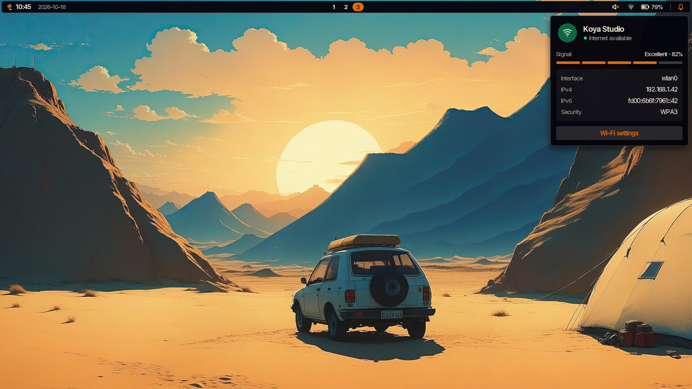
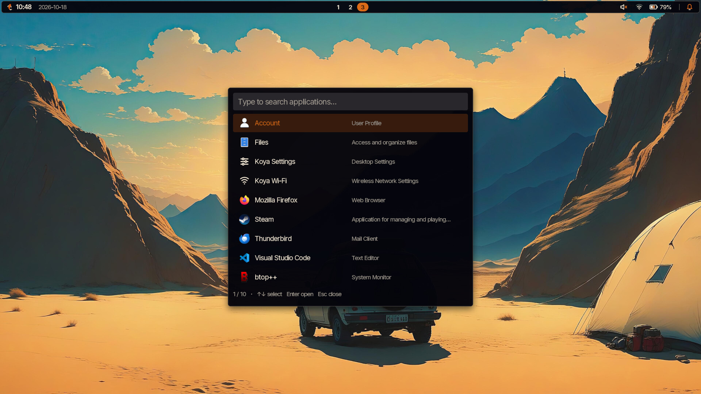
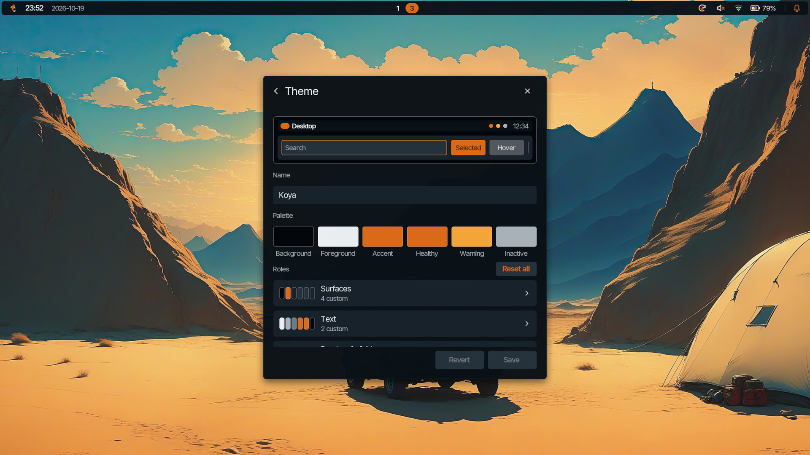
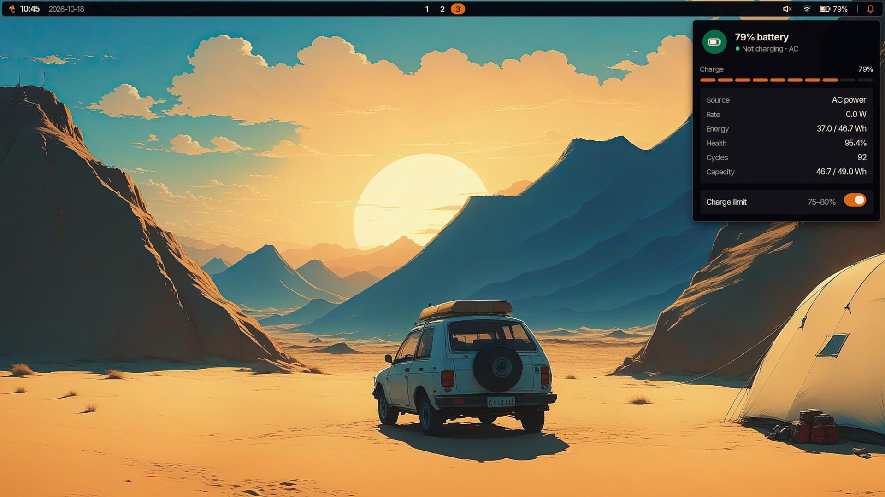
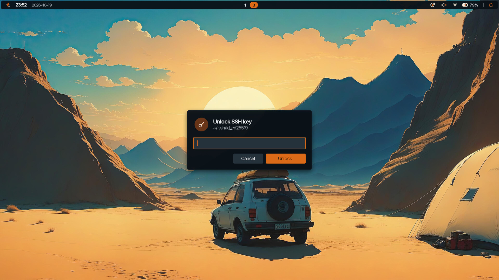
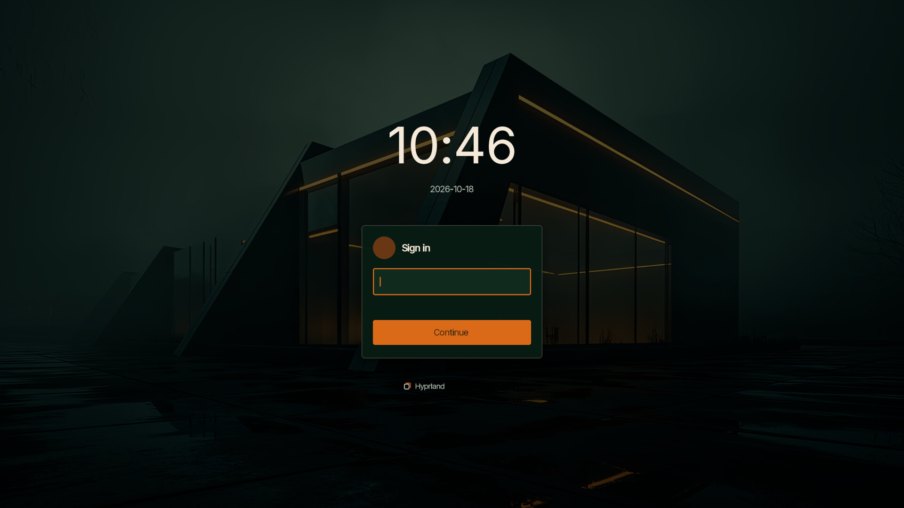
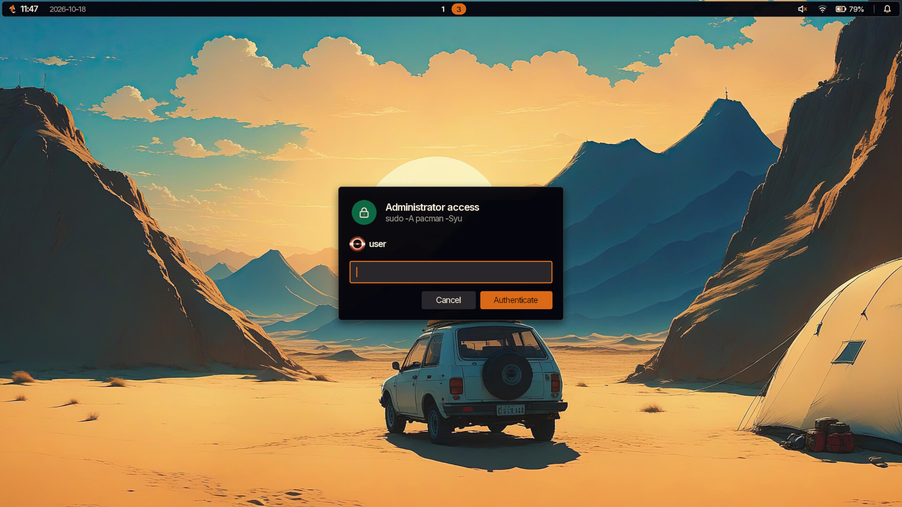

# Koya Bar

A desktop shell for Hyprland, built with [Koya](https://www.koya-ui.com/).

The shell's release version lives in [`VERSION`](VERSION), independently of the
Koya runtime version. Meson and release packaging should use this file. Run
`./run.sh --version` to print it without launching the shell.

<p align="center">
  
</p>

## Why this exists

Koya started here. I wanted UI elements on Hyprland while I was messing around
with Arch, so I wrote a lean Vulkan renderer, wired it straight into Wayland and
reused a UI model I'd already built for games.

It became a real project when I needed to replace Electron. I wanted the
iteration speed and absolute visual control of the web without dragging in a
whole web stack, and the performance and RAM bill that comes with it. That's
why it's JavaScript, with a layout and animation model that feels a bit like
CSS. Koya renders it on the GPU with no browser underneath.

Koya has since grown well beyond that. I use it every day for embedded, desktop
and game UI.

Koya Bar is where the original experiment ended up; a bar, application picker,
notifications, Wi-Fi, settings, a lock screen and a login greeter. It's the
primary shell on my main laptop, and it's the clearest way to show what Koya
can do on a large screen with a keyboard and mouse.

## Why you might want it

Most Linux desktops are assembled from parts. The bar comes from one project,
the launcher from another and the lock screen from a third, and each has its
own idea of what a button should look like. Getting them to agree takes a pile
of config files and a fair amount of compromise.

Koya Bar is one shell, from the login screen to the lock screen. Change the
theme once and everything follows it, including the greeter.

It's also meant to be looked at. I like text interfaces and they have their
place, but I also like the visual polish and consistency of macOS, and Linux
rarely gets that. Popovers drop in, meters light up segment by segment and busy
states animate rather than printing "Loading…". That doesn't cost what it
would in Electron; the whole shell sits at around 48 MB of memory.

That consistency carries through to passwords. Signing in, unlocking the
screen, unlocking an SSH key and approving `sudo` or a system change all happen
in the same dialog, rather than a terminal prompt or a window from some other
toolkit. It names what's asking, and a wrong password shakes it rather than
closing it.

And it's meant to be pulled apart. The UI is about 7,000 lines of plain
JavaScript in [`apps/`](apps/), with no build step. Native code only appears
where the system demands it; PAM, greetd, polkit and the SSH agent proxy. If
you don't like how something looks or behaves, change it.

<p align="center">
  <a href="docs/screenshots/launcher.jpg"></a>
  <a href="docs/screenshots/theme-editor.jpg"></a>
  <a href="docs/screenshots/power.jpg"></a>
  <a href="docs/screenshots/ssh-prompt.jpg"></a>
</p>

## What's included

| | |
| --- | --- |
| **Bar** | Workspaces, clock, OS update count, network, battery and power modes, volume and notifications, with a bar and wallpaper on every monitor |
| **Application picker** | Search across desktop entries that ignores case and accents, driven entirely from the keyboard |
| **Settings** | Theme editor with live preview, wallpapers, clock format and update check interval |
| **OS updates** | Official repository and AUR updates, package versions, administrator approval and installation output |
| **Wi-Fi** | Join, forget and manage saved networks |
| **Account** | Profile picture, display name, password and automatic login |
| **Lock screen** | Compositor session lock on every output, authenticated through PAM |
| **Login greeter** | A greetd greeter in the same visual language as the desktop |
| **SSH prompts** | Passphrase prompts for your existing ssh-agent, asked on first use |
| **Authorisation** | Polkit and sudo askpass prompts using the same password dialog |

Controls for hardware or services you don't have are hidden rather than greyed
out.

## Quick start

You'll need Hyprland, a Vulkan driver and Koya 0.7.1 or newer (see
[Requirements](#requirements)).

```bash
git clone https://github.com/Omnomios/koya-bar.git
cd koya-bar
./run.sh
```

To make it your session, add the absolute path to `run.sh` to Hyprland's
startup commands. Run one shell per session, and stop any existing bar or
wallpaper service first.

Each app also runs on its own. Bind `launcher.sh` to a shortcut in place of
`rofi -show drun`, for example:

```bash
./launcher.sh     # Application picker
./settings.sh     # Theme, wallpaper and clock
./account.sh      # Profile, password and sign-in options
./wifi.sh         # Wireless networks
./updates.sh      # OS updates (requires the running shell)
./lock.sh         # Lock the session
```

To add Account, Koya Settings, Koya Wi-Fi and OS Updates to other launchers and desktop
menus, run `./install-desktop-entries.sh`. It writes to
`${XDG_DATA_HOME:-~/.local/share}/applications`, or to the directory given as
its first argument. Entries point at this checkout, so rerun it after moving the
repo.

For extra translucency, enable Hyprland's blur for layer namespaces beginning
with `koya-`. Float the desktop portal's file chooser so it opens as a dialog.

## Requirements

- Installed Koya **0.7.1 or newer**, its shared assets, and matching Helix
  `dbus`, `hypr` and `process` plugins. Session locking also needs `pam`.
- A working Hyprland session and Vulkan driver.
- Meson, Ninja, a C++17 compiler, pkg-config and the `gio-unix-2.0` and
  `polkit-agent-1` development libraries to build this project's native modules.
- GdkPixbuf and its image loaders; librsvg for SVG icons.

Install only the services for the features you use:

| Feature | Service or tool |
| --- | --- |
| Network and Wi-Fi | NetworkManager |
| Battery and charge control | UPower |
| Power modes | power-profiles-daemon |
| Audio | PulseAudio or PipeWire's PulseAudio server, with `pactl`; optional pavucontrol for advanced settings |
| Account profiles | AccountsService (`accountsservice` on Arch) |
| Image chooser | xdg-desktop-portal and a file-chooser backend, such as GTK |
| Login greeter | greetd |
| SSH prompts | OpenSSH and an existing ssh-agent |
| Authorisation prompts | polkit; sudo for `sudo -A` |
| OS updates (Arch Linux) | pacman, pacman-contrib (`checkupdates`), sudo; yay, base-devel and git for AUR support |
| Idle locking | hypridle |

`run.sh` uses the installed Koya and builds this project's native modules into
`build/`. For a nonstandard installation, set `KOYA_BIN`, `KOYA_ASSET_DIR` and
`KOYA_PLUGIN_DIR` to the executable, its matching shared assets and its
plugins. Assets default to `../share/koya/assets` relative to the executable.

## Bar controls

- **Koya logo:** opens the session menu with Lock, Log Out, supported sleep
  options, Restart and Shut Down. Log Out, Restart and Shut Down ask for
  confirmation. Power actions use logind's normal inhibitors and authorisation.
- **Network:** connection summary, addresses and connectivity; **Configure
  Wi-Fi** opens the Wi-Fi app for joining and managing saved networks.
- **Battery:** status, time estimates, power rate, energy, health and cycles.
  Supported batteries get an individual charge-control switch using UPower's
  configured preset. Available power modes come from power-profiles-daemon.
- **Audio:** click the speaker for volume, mute and **Sound Output** selection.
  Outputs show device icons and a checkmark on the active choice. Selecting
  a device or port changes the default and moves current playback; analogue
  and digital profile changes retain the current input profile when supported.
  The list follows connected devices and the slider follows external changes.
  **Sound Settings** opens pavucontrol when installed.
- **Notifications:** banners and history with actions, dismissal and clear-all.
  History remains in memory until the shell exits.
- **OS updates:** update icon and package count; click to open the updates window.
  `0` means up to date, `…` means checking or installing, `—` means not yet
  checked, and `!` means a check failed or a required tool is missing.

Controls for unavailable hardware or services are omitted. System changes use
the corresponding service's existing authorisation policy.

## Settings

**Theme** opens the theme editor. Edit the base palette and individual surfaces,
text, borders, dividers, highlights, status colours and shadows. The colour
picker supports HSV, RGBA and hex. The preview follows the draft; **Save theme**
applies it to open shell apps. Unsaved drafts survive page navigation and are
discarded when Settings closes. Invalid or unreadable drafts cannot be saved.

**Wallpaper** offers bundled artwork and an image chooser for your own files.
**Show on login screen** shares the selected wallpaper with the greeter for
this account. Imported images are cached and only the selected rendered image
is copied to the greeter's cache.

**Date & time** controls 24/12-hour time, date visibility and seconds. Dates use
ISO `YYYY-MM-DD` format. The bar and lock screen use the same saved options.

Preferences are saved atomically to
`${XDG_CONFIG_HOME:-~/.config}/koya-bar/settings.json`. Settings and Account
release their input and hide while a file chooser or an authorisation prompt
is open.

## OS updates

Open the updates window from the bar, `./updates.sh`, the desktop entry, or
**Settings → OS updates**. It lists available packages with their installed
and new versions, labels repository and AUR packages, and offers **Check now**.
The running shell owns the checks and installations, sharing results across
all monitors and windows. Failed checks keep the last known results and show
the failure rather than reporting that the system is up to date.

On Arch Linux, install `pacman-contrib` for repository checks and `yay`,
`base-devel` and `git` for AUR support. `base-devel` supplies the package build
tools, including `fakeroot`, GCC and make. Repository checks use
[`checkupdates`](https://man.archlinux.org/man/checkupdates.8.en), which refreshes
a separate database without changing the system's package database or asking
for administrator access. AUR checks use `yay -Qua`. When `yay` is absent,
AUR checks are skipped and its settings option is hidden. Missing repository
tools and network failures appear in the updates window.

**Settings → OS updates → Check interval** offers manual checks only, every
15 or 30 minutes, hourly, every 3, 6 or 12 hours, and daily. The default is
hourly, including a check when the shell starts. Changes apply immediately.
Automatic checks never install packages. **Include AUR packages** is enabled
by default when `yay` is installed and can be disabled for repository-only upgrades. Custom intervals
are accepted in the saved `UpdatesCheckInterval` preference: `0` disables
automatic checks; integer values from `15` to `10080` specify minutes.

**Hide icon when no updates** hides the bar icon when idle with no updates.
It stays visible during checks or installations and when a check fails.
This option is off by default and applies immediately.

**Update** requests administrator approval
through the shell's existing sudo askpass dialog, then runs a full
`yay -Syu` upgrade (or `sudo -A pacman -Syu` with AUR disabled or `yay` absent). AUR builds run
as the current user. The GUI uses `--noconfirm`: package-manager questions use
their default answers and build-file review is skipped. Use your usual terminal
workflow when an upgrade needs interactive review or choices.

The window lists waiting packages by source (Arch Linux, AUR) with the new
version over the old; a new leading version number is shown in the accent
colour, and kernel, firmware, microcode, systemd, glibc and NVIDIA packages are
marked *Restart required*. While installing, the same list shows each
package's progress (read from pacman's and yay's output) with the current step
and package. **Output** shows the package manager's own output. Closing the window leaves the
upgrade running in the shell; reopen it to follow progress. The GUI does not
terminate or time out an installation. A successful installation checks again
to refresh the package list and bar count. Logs remain in memory for the shell's
lifetime.

## Account

The separate Account app edits the current user's AccountsService profile.
Choose a picture, edit your display name and email, or open the password page.
Images are centred, cropped to a square and converted to a 256px PNG. The
greeter and lock screen follow profile changes and fall back to initials when
no image is available. Authentication always uses the login name.

Password changes run through `passwd` on a private terminal. The app reports
the system's refusal and clears password fields after use. Automatic login
requires the greeter installation below and administrator authorisation.

## Application picker

Type to search desktop entries by name, keywords, description or executable;
matching ignores case and accents.

Use Up/Down or Tab to select, Page Up/Down to move through results, Enter to
launch, and Escape to close. Left/Right, Home/End, Backspace and Delete edit the
query; Ctrl+U clears it, Ctrl+W removes a word and Ctrl+A/Ctrl+E move to either
end. Input methods supply text composition. A second invocation is ignored
while the picker is open.

Applications launch through GIO's desktop-entry handling, including terminal
entries, Exec field codes and D-Bus activation.

## Login greeter

<p align="center">
  <a href="docs/screenshots/greeter.jpg"></a>
</p>

The greeter discovers installed Wayland sessions and asks greetd to authenticate
and start the selected session. After logout, greetd shows the greeter again.
Configure the chosen desktop session to start `run.sh` itself.

Build the native modules, then install from a checkout that will remain
accessible before login:

```bash
meson setup build             # --reconfigure if already configured
meson compile -C build
sudo ./install-greeter.sh
```

The installer enables greetd at boot and configures tty1. It installs the
launcher, native modules and automatic-login helpers under `/usr/local`, saves
the previous greetd configuration as `/etc/greetd/config.toml.before-koya`, and
links `/usr/local/share/koya-greeter` to this checkout. JavaScript and assets
remain in the repo for development; rerun the installer after native changes.
System plugins load from their installed locations.

Log out of the desktop before starting the service, for example from SSH:

```bash
sudo systemctl start greetd
```

The raw greeter runs as root for DRM, input-device and VT access. greetd starts
the desktop as the authenticated user. Escape or Back cancels authentication;
secret prompts stay masked. The last account and its opted-in wallpaper are
recalled, and AccountsService supplies its last selected session.

The Account app's **Automatic** switch uses polkit to record automatic login
in `/etc/koya-greeter/autologin`. The installed greetd wrapper builds its runtime
configuration under `/run/koya-greeter/` and adds an initial session for that
account. greetd starts it once at boot; signing out returns to the greeter.

For a preview inside an existing desktop, without real authentication:

```bash
koya -m /usr/share/koya/assets -m . -n build/native/modules -i demos/login-window-preview.js
```

Use any user name and the preview password `koya`. Escape exits the preview.
For raw output, use `sudo ./greeter.sh --preview --raw-tty /dev/tty3` from that
active, available VT. `KOYA_GREETER_WALLPAPER` selects the system wallpaper by
built-in id; `KOYA_GREETER_STATE_DIR` overrides `/var/lib/koya-greeter`.

## Session locking

`lock.sh` creates compositor session-lock surfaces on every output and checks
the current account through PAM. It releases the lock only after authentication
and confirmation that the compositor still owns the lock. Escape clears the
password. Locking works independently of the status shell.

Merge `build/hypridle.example.conf` into your existing hypridle configuration
for idle, sleep and logind lock requests. `KOYA_PAM_SERVICE` selects the PAM
service; the default is `login`. A custom service needs both authentication and
account-policy rules.

## SSH keys

The shell provides a proxy for an existing OpenSSH agent. It discovers paired
private and `.pub` files directly in `~/.ssh`, advertises the public keys and
asks for a passphrase on first use. Only `ssh-add` decrypts the private key;
unlocked keys remain in the upstream agent's memory. No passphrases are saved.

Configure the desktop session's environment before launching SSH clients:

```bash
export KOYA_SSH_UPSTREAM="$XDG_RUNTIME_DIR/ssh-agent.socket"
export SSH_AUTH_SOCK="$XDG_RUNTIME_DIR/koya-ssh/agent.sock"
```

Set the upstream path to your existing agent's socket and keep its service
enabled. Clients must inherit the proxy address; open new terminals after
changing it. Loaded keys retain their confirmation, lifetime and destination
restrictions. Lock and unlock through the proxy so it can track agent locking.

`./ssh-add.sh [options or key paths]` opens a Koya passphrase prompt for manual
loads. Ordinary `ssh-add` remains available for terminal prompts. Keys outside
`~/.ssh` need a manual load; custom `IdentityAgent` settings bypass this proxy.
Closing Koya leaves the upstream agent running but makes the proxy unavailable
until the shell starts again.

## GUI authorisation

Koya registers a polkit agent for its login session. Remove other polkit agents
from the session's startup commands so they do not compete for registration.
Polkit, askpass and SSH key prompts share the existing password dialog and appear
one at a time. Pending requests are cancelled when the session locks, becomes
inactive or prepares to sleep.

<p align="center">
  <a href="docs/screenshots/sudo-prompt.jpg"></a>
</p>

The dialog says what is asking. Polkit requests are titled with their action,
such as "Switch power profile". For askpass, the shell looks up the process
behind the request: when it's Koya's helper, the dialog shows the command that
started it, such as `sudo -A pacman -Syu`; any other caller is shown as itself,
so it can't borrow sudo's name. This is for your information, not a security
boundary; any program running as you can still draw its own window.

A wrong password keeps the dialog open. It shakes, clears the field and says
so beside the buttons. Polkit allows three attempts per request, matching
sudo's default, and sudo's own retries reopen the dialog already marked as
refused.

For GUI password prompts from applications launched by Hyprland, add these
environment variables to its configuration, using your checkout's absolute path:

```lua
hl.env("SUDO_ASKPASS", "/absolute/path/to/koya-bar/build/native/modules/koya-askpass")
hl.env("SSH_ASKPASS", "/absolute/path/to/koya-bar/build/native/modules/koya-askpass")
```

Log in again so new applications inherit them. `run.sh` also sets these variables
for applications launched by Koya. Use `sudo -A command` to request the GUI;
ordinary `sudo` continues to prompt in the terminal. OpenSSH uses the helper
when it requests askpass. No sudoers or PAM changes are needed.

The Koya lock screen reports its lock state to logind. An alternative locker
must also maintain logind's `LockedHint` for authentication prompts to follow
its lock state.

## Develop and test

UI code is in `apps/`, artwork in `assets/`, and native modules in
`native/modules/`. Plugin SDK headers are bundled in `native/sdk/`.

Run the focused login, locking, account, authentication and update checks with Node.js:

```bash
npm test
```

For native integration checks:

```bash
meson setup build
meson compile -C build
meson test -C build
./tests/run.sh
```

Native checks cover the SSH proxy, password changes, greetd handoff, automatic
login, charge-control writes and privileged greeter file handling. They use
disposable keys, an isolated agent, a private D-Bus and temporary settings and
sockets.

To preview the updates GUI with fake packages and preferences, run it on a
private D-Bus. No package-manager commands run. The preview exercises the
updates pages, Settings and bar states, saves Vulkan captures under
`/tmp/koya-updates-preview/`, then exits:

```bash
dbus-run-session -- koya -m /usr/share/koya/assets -m . -n build/native/modules -i tests/updates-preview.js
```

`raw-unlock-demo.sh` is a password-screen demo for an active, available VT. It
does not unlock LUKS or change boot configuration. Its demo password is `koya`.

## Licence

Project material is released under Creative Commons Attribution 4.0
International; see [LICENSE](LICENSE) and [NOTICE](NOTICE). The bundled Inter
fonts and QuickJS header retain their original licences.
